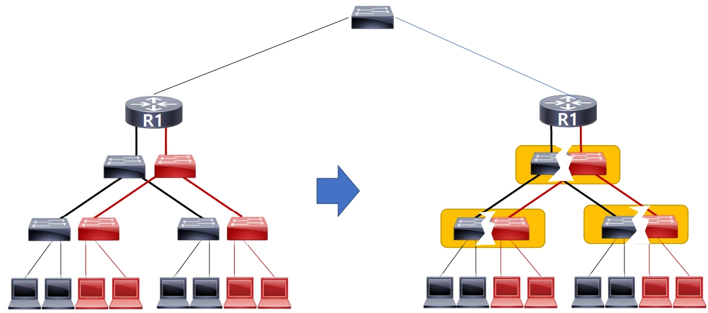
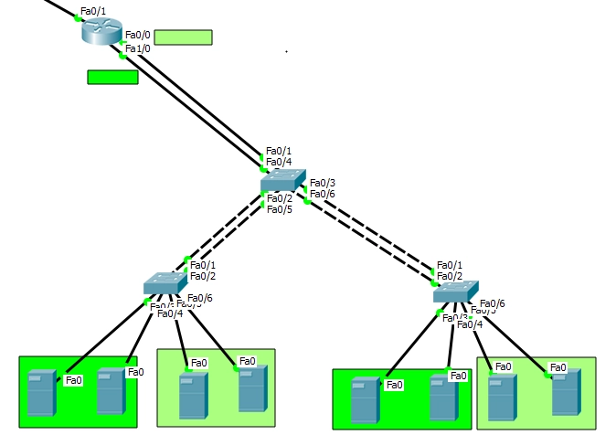
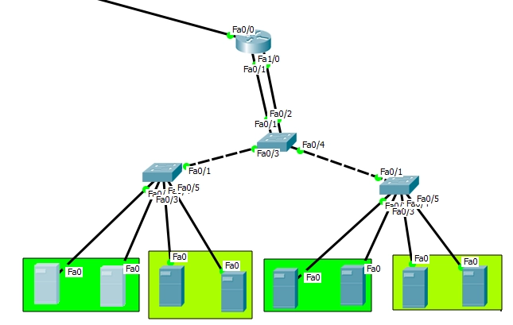

> **실습 목표** · 스위치 포트를 VLAN별로 나누고 스위치 사이에 트렁크를 구성한다. 여러 VLAN의 트래픽이 하나의 링크를 공유하면서도 논리적으로 분리되는 원리를 익힌다.

스위치에 VLAN을 설정하여 논리적인 두 개의 스위치로 동작하는 환경을 구축해보자.



- VLAN 설정하기
    
    아래와 같이 하나의 스위치에 VLAN 만큼의 케이블을 추가로 연결해준다. (이 때, 초록색 영역은 **10.1.3.X** 대역이고, 연두색 영역은 **10.1.4.X** 대역을 사용한다.)
    
    
    
    최상위에 위치한 라우터에는 라우터의 세 가지 기본 명령을 사용하여 IP 주소를 각각 **10.1.3.1**과 **10.1.4.1**을 할당해준다.
    
    이후, 3개의 스위치마다 콘솔에서 아래의 명령어를 입력하면 VLAN 설정이 완료된다. 아래는 가장 위에 위치한 Switch를 기준으로 명령어를 입력하는 과정을 보여준다.
    
    ```
    Switch> enable
    Switch# configure terminal
    
    // vlan 10, vlan 20 생성(= 논리적인 분할)
    Switch(config)# vlan 10
    Switch(config-vlan) vlan 20
    
    // vlan 설정에서 탈출
    Switch(config-vlan) exit
    
    // 스위치의 0/4 포트에 접근하고, vlan 10 할당
    Switch(config-if)# interface fastEthernet 0/4
    Switch(config-if)# switchport access vlan 10
    Switch(config-if)# exit
    
    // 스위치의 0/1 포트에 접근하고, vlan 20 할당
    Switch(config-if)# interface fastEthernet 0/1
    Switch(config-if)# switchport access vlan 20
    Switch(config-if)# exit
    
    // 스위치의 0/2 포트에 접근하고, vlan 10 할당
    Switch(config-if)# interface fastEthernet 0/2
    Switch(config-if)# switchport access vlan 10
    Switch(config-if)# exit
    
    // 스위치의 0/5 포트에 접근하고, vlan 20 할당
    Switch(config-if)# interface fastEthernet 0/5
    Switch(config-if)# switchport access vlan 20
    Switch(config-if)# exit
    
    // 스위치의 0/6 포트에 접근하고, vlan 10 할당
    Switch(config-if)# interface fastEthernet 0/6
    Switch(config-if)# switchport access vlan 20
    Switch(config-if)# exit
    
    // 스위치의 0/3 포트에 접근하고, vlan 20 할당
    Switch(config-if)# interface fastEthernet 0/3
    Switch(config-if)# switchport access vlan 20
    Switch(config-if)# exit
    ```
    
    위와 같은 절차대로 하위에 위치한 스위치 2개도 동일하게 명령어를 입력해주면 된다.
    

- TRUNK를 적용하여 VLAN 설정하기
    
    TRUNK를 적용하면 아래와 같이 케이블을 적게 사용하여 VLAN을 구축하는 것이 가능하다. 
    
    (초록색 영역은 **10.1.6.X** 대역을 사용하고, 연두색 영역은 **10.1.7.X** 대역을 사용한다.)
    
    
    
    최상위에 위치한 라우터에 라우터 기본 명령을 사용하여 각각 **10.1.6.X**,  **10.1.7.X**을 할당한다.
    
    이후로, 가장 위에 위치한 스위치에 다음과 같은 명령어를 입력하여 VLAN을 설정해준다.
    
    ```
    Switch> enable
    Switch# configure terminal
    
    // vlan 10, vlan 20 생성(= 논리적인 분할)
    Switch(config)# vlan 10
    Switch(config-vlan) vlan 20
    
    // vlan 설정에서 탈출
    Switch(config-vlan) exit
    
    // 스위치의 0/1 포트에 접근하고, vlan 10 할당
    Switch(config-if)# interface fastEthernet 0/1
    Switch(config-if)# switchport access vlan 10
    Switch(config-if)# exit
    
    // 스위치의 0/2 포트에 접근하고, vlan 20 할당
    Switch(config-if)# interface fastEthernet 0/1
    Switch(config-if)# switchport access vlan 20
    Switch(config-if)# exit
    
    // 스위치의 0/3 포트에 접근하고, Trunk 모드 설정
    Switch(config-if)# interface fastEthernet 0/3
    Switch(config-if)# switchport mode trunk
    Switch(config-if)# exit
    
    // 스위치의 0/4 포트에 접근하고, Trunk 모드 설정
    Switch(config-if)# interface fastEthernet 0/4
    Switch(config-if)# switchport mode trunk
    Switch(config-if)# exit
    ```
